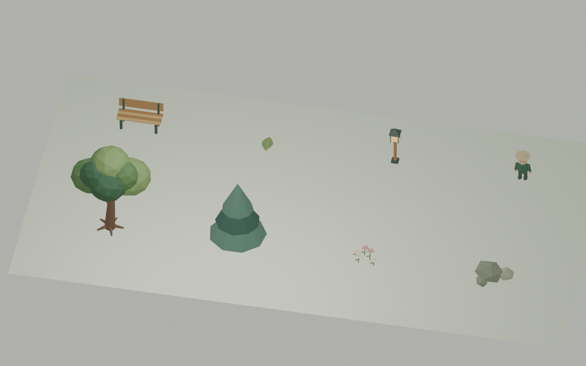

# 마음정원 Blender 모델

Blender 4.5.15 LTS에서 `bpy`로 제작한 편집 원본과 웹 실행용 모델입니다. 기본 부품 제작·베벨·재질 설정·모델 조립을 Blender에서 수행합니다. 외부 모델·이미지·텍스처는 사용하지 않았습니다.

## 파일과 모델

- `maeum-garden.blend`: 모델 8종과 미리보기용 조명·카메라가 있는 원본
- `manifest.json`: 제작 도구·원본 SHA256·모델 크기·메시/삼각형/파일 용량
- `../../scripts/build_blender_assets.py`: 최초 모델 제작 재현 스크립트
- `../../scripts/export_blender_assets.py`: 저장한 원본의 수정 내용을 GLB로 내보내기
- 웹 파일: `apps/client/public/assets/models/blender/`

| Collection / 루트 이름 | 모델 |
|---|---|
| tree-canopy | 가지·뿌리·여러 수관을 가진 활엽수 |
| tree-pine | 층을 나눈 침엽수 |
| flower-patch | 줄기·잎·크림/분홍 꽃잎·꽃가루를 가진 꽃밭 |
| rock-cluster | 바위 세 개와 이끼 |
| garden-bench | 좌판·등받이·지지대가 있는 벤치 |
| floating-leaf | 곡면과 두께·잎맥을 가진 나뭇잎 |
| garden-lantern | 프레임·지붕·발광 재질을 가진 등불 |
| garden-visitor | 모자·얼굴·팔·다리·옷을 가진 정적 방문자 |

Collection마다 부품을 개별 메시로 유지합니다. 모델의 로컬 원점은 바닥 중심이며 단위는 미터입니다. 원본은 Blender Z-up, 웹 GLB는 내보내기에서 Y-up으로 변환합니다. 방문자에는 현재 리깅이나 걷기 애니메이션을 적용하지 않았습니다.

## Blender에서 수정한 뒤 적용

1. Blender에서 `maeum-garden.blend`를 엽니다.
2. 해당 Collection의 개별 부품과 재질을 수정합니다. 위 루트 이름과 모델 루트의 기본 크기를 유지합니다.
3. 같은 원본 파일에 저장합니다.
4. 저장소 루트에서 아래 명령을 실행합니다. `blender` 대신 설치한 실행 파일 경로를 사용할 수 있습니다.

```powershell
blender --background asset-sources/blender/maeum-garden.blend --python scripts/export_blender_assets.py
npm.cmd run check:models
```

이 명령은 저장한 모델을 불러와 GLB와 manifest만 갱신합니다. 원본의 부품/Collection과 수정 내용을 재모델링하지 않습니다. 웹용 복사본에서만 부품 메시를 합쳐 재질별 draw call을 줄입니다. 원본을 수정하고 재내보내지 않으면 SHA256 검사가 차이를 알립니다.

전체 초기 모델을 다시 생성하려면 아래 명령을 사용합니다. **이 명령은 원본을 초기 제작 상태로 다시 만드므로 수작업 수정 후에는 위 재내보내기 명령을 사용합니다.**

```powershell
blender --background --factory-startup --python scripts/build_blender_assets.py
```

## 실제 실행

클라이언트의 `blender-models.ts`가 GLTFLoader로 모델 8종을 한 번씩 읽고 공유 복사본을 배치합니다. 나무·꽃·바위·벤치·나뭇잎·등불은 정원에, 방문자는 로컬/원격 아바타에 사용합니다. 모델 로딩 실패 때는 기본 도형으로 산책을 계속할 수 있습니다.

현재 꽃과 나뭇잎은 배경 모델입니다. 호흡 완료 시 꽃이 피는 기능과 고민 나뭇잎 이동 기능은 별도 개발 단계입니다. 모델 준비를 해당 활동의 구현 완료로 기록하지 않습니다.

Blender 실행 파일은 Git 저장소에 포함하지 않습니다. 이번 제작에는 [공식 Blender 4.5 배포본](https://download.blender.org/release/Blender4.5/)을 사용하고 공식 SHA256과 비교했습니다. 다운로드한 ZIP의 SHA256은 `52dd02fd74877fa08e74b67d7854cf32468a232c02aaa19b6844c91285574f8d`입니다. 팀원은 동일 Blender LTS 계열을 설치해 원본을 열 수 있습니다.


