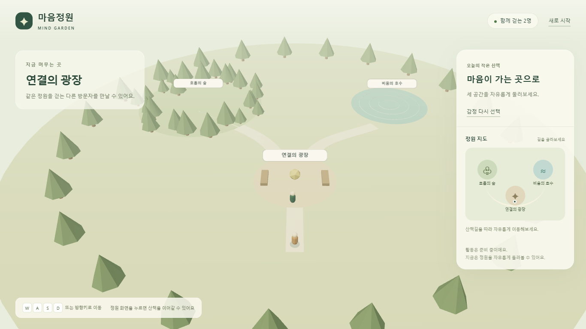

# 마음정원 단계별 진행 기록

## 2026.10.12 · 준비자료 등록

- 요구사항·화면 흐름·기술/통신 계약·환경 안내·작업표·테스트/평가 양식 작성
- 준비자료 정합성 검사와 공통 TypeScript 계약 검사 통과
- 공개용 계획서 사본에서 학번 제거, 원본은 로컬 보관
- GitHub 저장소: https://github.com/ChoiPython/maeum

실제 구현과 실행 검증은 1단계 개발 기록에서 별도로 보고합니다.

## 2026.10.12 · 1단계 기반 구현

사용자 흐름: 시작 안내와 체크인에서 감정을 선택하고 정원을 걷습니다. 브라우저의 개인 상태는 추천 UI에 사용하고, 이동 좌표만 Socket.IO 서버의 검증을 거쳐 다른 브라우저에 표시됩니다.

| 경계/항목 | 실제 확인 결과 |
|---|---|
| 설치 | npm workspaces와 잠금 파일 생성, 설치 시 npm audit 0 vulnerabilities |
| 정적 검사 | client/server TypeScript strict 검사 통과 |
| 테스트 | 추천/구역, 개인 데이터 거절, 인원/중복 입장, 이동 검증, 빈도 제한, 실제 접속 통합 등 6개 통과 |
| 빌드 | client Vite 빌드와 server tsc 빌드 통과 |
| GitHub Actions | Ubuntu·Node 22.14.0에서 새 `npm ci`와 `npm run check` 성공: [검사 실행](https://github.com/ChoiPython/maeum/actions/runs/38223658921) |
| 서버 | 웹 HTTP 200, `/health`에서 status ok·stage 1 응답 |
| 화면 | 1366×768 Chromium에서 시작·체크인·추천·지도·정원 표시 |
| 감정 추천 | anxiety/tired→숲, overloaded→호수, lonely→광장, calm→자유 선택 모두 확인 |
| 모델 | 자체 생성 5,296바이트 나무 GLB가 GLTFLoader에서 로딩됨 |
| 실제 이동 | W 입력으로 z=18에서 z=11.95로 이동, 연결의 광장 판정 |
| 실제 두 화면 | 각각 ‘함께 걷는 2명’, 서로의 원격 아바타 1개 확인 |
| 개인 데이터 | 확인한 소켓 frame에 감정/고민/긴장감/편안함 없음, localStorage/sessionStorage 비어 있음 |
| 브라우저 오류 | 정상 흐름에서 pageerror와 error console 0개 |
| 입력과 초기화 | UI 선택 중 이동 입력 차단, 미응답 자유 추천, 새 체험에서 감정/점수 초기화 확인 |

현재 구현은 1단계 산책과 접속 기반입니다. 호흡·호수 활동·응원·체크아웃은 구현하지 않았습니다. 실제 다른 PC/LAN, Chrome·Edge 각각의 최종 확인, 5명 브라우저 부하와 구역별 30초 FPS, 대학생 평가는 아직 남아 있습니다.

모델은 코드로 생성한 최소 샘플이며 Blender 모델 편집 숙련도 검증이나 외부 에셋 확보로 간주하지 않습니다. 초기 빌드의 3D JavaScript 묶음은 약 697KB(전송 gzip 약 182KB)이며 Vite의 500KB 묶음 경고가 있습니다. 다음 연출/모델 통합 단계에서 분할과 실측 성능을 확인합니다.

개발 서버 기본 포트를 3002로 변경했습니다. 현재 PC의 3001은 기존 VS Code 프로세스가 사용하고 있어 그 서비스를 유지했습니다. 실행 URL과 프록시·환경 예시를 함께 맞췄습니다.

다음 순서는 60초 호흡 활동의 시작·정지·재개·재시작과 개인 안개·꽃입니다.
