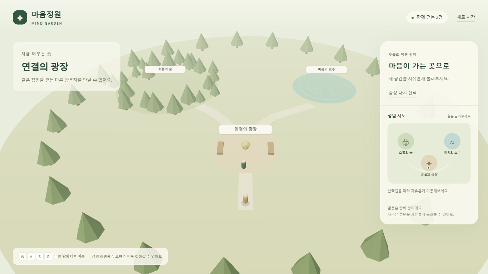
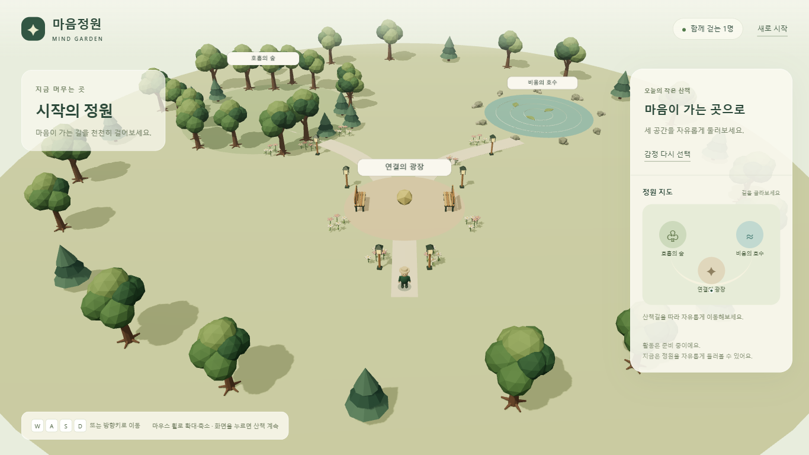
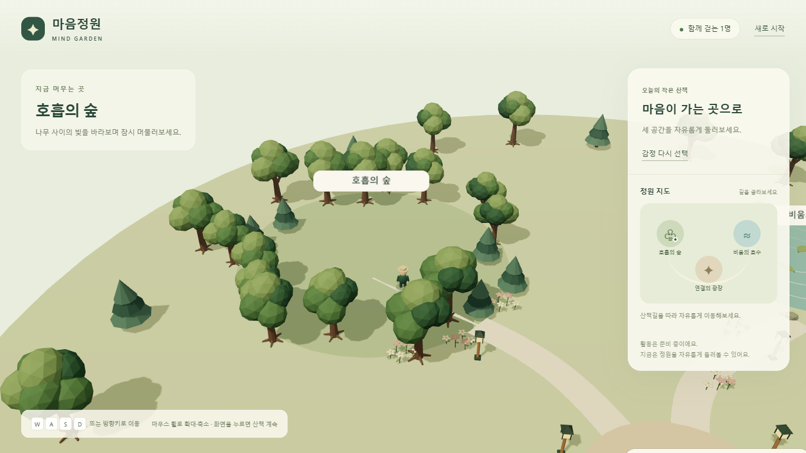
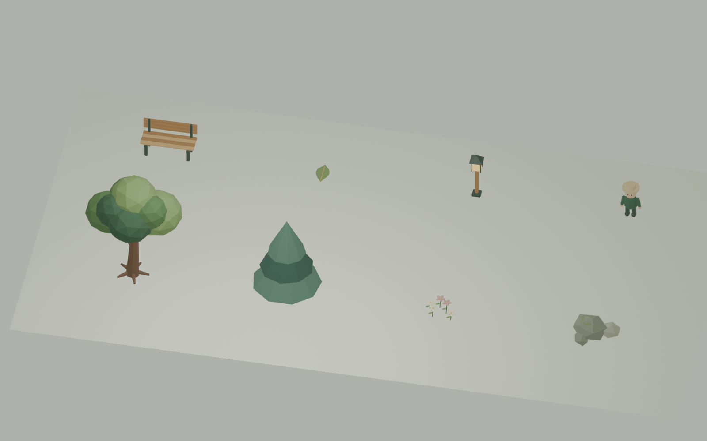

# 마음정원 단계별 진행 기록

## 2026.10.12 · 준비자료 등록

- 요구사항·화면 흐름·기술/통신 계약·환경 안내·작업표·테스트/평가 양식 작성
- 준비자료 정합성 검사와 공통 TypeScript 계약 검사 통과
- 공개용 계획서 사본에서 학번 제거, 원본은 로컬 보관
- GitHub 저장소: https://github.com/ChoiPython/maeum

실제 구현과 실행 검증은 1단계 개발 기록에서 별도로 보고합니다.

## 2026.10.12 · 1단계 기반 구현

사용자 흐름: 시작 안내와 체크인에서 감정을 선택하고 정원을 걷습니다. 브라우저의 개인 상태는 추천 UI에 사용하고, 이동 좌표만 Socket.IO 서버의 검증을 거쳐 다른 브라우저에 표시됩니다.

| 경계/항목 | 실제 확인 결과 |
|---|---|
| 설치 | npm workspaces와 잠금 파일 생성, 설치 시 npm audit 0 vulnerabilities |
| 정적 검사 | client/server TypeScript strict 검사 통과 |
| 테스트 | 추천/구역, 개인 데이터 거절, 인원/중복 입장, 이동 검증, 빈도 제한, 실제 접속 통합 등 6개 통과 |
| 빌드 | client Vite 빌드와 server tsc 빌드 통과 |
| GitHub Actions | Ubuntu·Node 22.14.0에서 새 `npm ci`와 `npm run check` 성공: [검사 실행](https://github.com/ChoiPython/maeum/actions/runs/38223658921) |
| 서버 | 웹 HTTP 200, `/health`에서 status ok·stage 1 응답 |
| 화면 | 1366×768 Chromium에서 시작·체크인·추천·지도·정원 표시 |
| 감정 추천 | anxiety/tired→숲, overloaded→호수, lonely→광장, calm→자유 선택 모두 확인 |
| 모델 | 자체 생성 5,296바이트 나무 GLB가 GLTFLoader에서 로딩됨 |
| 실제 이동 | W 입력으로 z=18에서 z=11.95로 이동, 연결의 광장 판정 |
| 실제 두 화면 | 각각 ‘함께 걷는 2명’, 서로의 원격 아바타 1개 확인 |
| 개인 데이터 | 확인한 소켓 frame에 감정/고민/긴장감/편안함 없음, localStorage/sessionStorage 비어 있음 |
| 브라우저 오류 | 정상 흐름에서 pageerror와 error console 0개 |
| 입력과 초기화 | UI 선택 중 이동 입력 차단, 미응답 자유 추천, 새 체험에서 감정/점수 초기화 확인 |

현재 구현은 1단계 산책과 접속 기반입니다. 호흡·호수 활동·응원·체크아웃은 구현하지 않았습니다. 실제 다른 PC/LAN, Chrome·Edge 각각의 최종 확인, 5명 브라우저 부하와 구역별 30초 FPS, 대학생 평가는 아직 남아 있습니다.

모델은 코드로 생성한 최소 샘플이며 Blender 모델 편집 숙련도 검증이나 외부 에셋 확보로 간주하지 않습니다. 초기 빌드의 3D JavaScript 묶음은 약 697KB(전송 gzip 약 182KB)이며 Vite의 500KB 묶음 경고가 있습니다. 다음 연출/모델 통합 단계에서 분할과 실측 성능을 확인합니다.

개발 서버 기본 포트를 3002로 변경했습니다. 현재 PC의 3001은 기존 VS Code 프로세스가 사용하고 있어 그 서비스를 유지했습니다. 실행 URL과 프록시·환경 예시를 함께 맞췄습니다.

다음 순서는 60초 호흡 활동의 시작·정지·재개·재시작과 개인 안개·꽃입니다.

## 2026.11.04 · Blender 제작 모델 적용

Blender 4.5.15 LTS를 실제 실행하여 모델 8종을 제작했습니다. 각 모델은 부품별 메시·재질을 가진 Collection으로 보관하고, 저장한 `.blend`에서 웹용 복사본을 결합해 개별 GLB로 내보냅니다. 스크립트 기반 Blender 모델링이며 원본은 Blender UI에서 편집할 수 있습니다.

| 항목 | 확인한 결과 |
|---|---|
| 모델 | 활엽수·침엽수·꽃밭·바위·벤치·나뭇잎·등불·정적 방문자 8종 |
| 원본 | `asset-sources/blender/maeum-garden.blend`, 8개 모델 Collection과 촬영용 조명/카메라 |
| 제작 재현 | `scripts/build_blender_assets.py`를 Blender에서 실행해 메시·재질·원본·GLB 생성 |
| 편집/재내보내기 | 저장한 `.blend`를 Blender에서 다시 열어 `scripts/export_blender_assets.py` 실행 성공 |
| 원본 연결 | manifest의 원본 SHA256, 각 GLB의 Blender exporter·형식·크기·메시 검사 통과 |
| 용량 | 모델 8종 GLB 합계 511,532바이트(499.5KiB), 종류별 원형 합계 11,020 triangles |
| 웹 적용 | GLTFLoader에서 8/8 로딩, 정원 장식 70곳과 로컬/원격 방문자에 적용 |
| 브라우저 이동 | 키보드로 숲 진입(x=-12.05, z=-7.05), 마우스 휠 확대·축소 확인 |
| 부분 로딩 실패 | 활엽수 요청을 의도적으로 차단: 7종 로딩·안내·기본 도형·이동 유지, 차단 해제 후 8종 복원 |
| 두 화면 | 양쪽 모두 모델 8종 로딩, 원격 아바타 표시 및 상대 종료 후 제거 확인 |
| 실행 오류 | 위 브라우저 흐름의 JavaScript pageerror 0개 |
| 기존 검사 | 준비자료·모델·클라이언트/서버 타입·테스트 6개·빌드 통과 |
| GitHub CI | 새 설치 환경의 `npm ci`와 전체 검사 성공: [Blender 모델 커밋 검사](https://github.com/ChoiPython/maeum/actions/runs/41786738808) |

숲 확대 화면에서 브라우저의 1초 구간 표시가 60FPS였고 draw call 167개·삼각형 52,922개가 표시됐습니다. 이는 짧은 확인값이며, 구역별 30초·5명 부하의 정식 성능 평가와 구분합니다. 전체 화면은 약 273 draw call·90,562 triangles였습니다. 정적 장면의 그림자는 모델 로딩 후 갱신하고, 아바타는 가벼운 접지 그림자를 사용합니다.

모델 외형과 렌더링을 개선한 작업입니다. 호흡 타이머·완료 꽃 연출, 고민 흘려보내기, 응원, 체크아웃 기능은 아직 별도 구현 단계입니다. 현재 꽃·나뭇잎은 배경 모델이며 방문자는 리깅/걷기 애니메이션 없는 정적 모델입니다.

Blender 실행 파일과 ZIP은 Git에서 제외된 작업용 `tmp/tools/`에 두었습니다. 공식 ZIP의 SHA256을 확인했으며, 저장소에는 제작 코드·`.blend`·GLB·manifest·작업 안내를 공유합니다.

