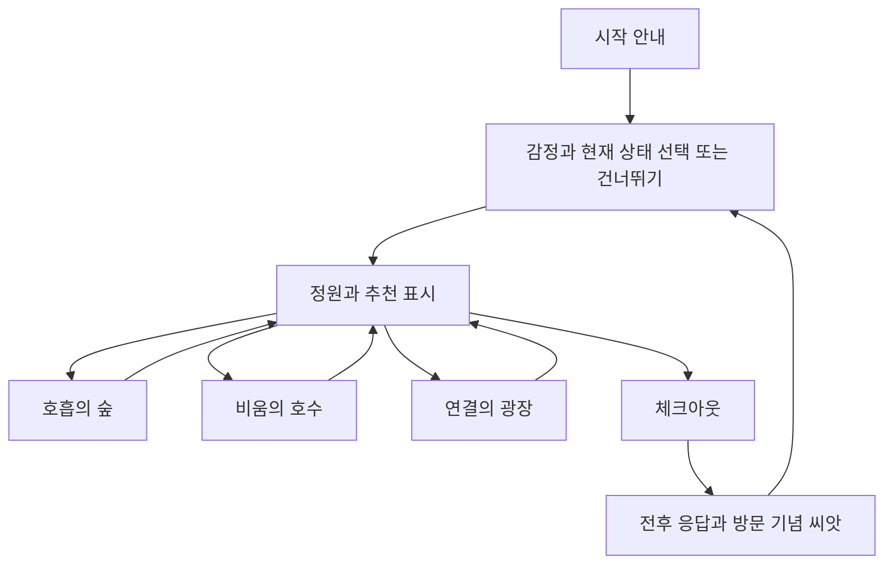

# 화면과 체험 흐름

아래 화면 구조와 배치는 구현 시작용 제안입니다. UI는 일반 HTML·CSS로 만들고 3D 캔버스 위에 겹칩니다. 실제 시안과 UI 구현은 이후 작업입니다.

## 화면 목록

| 화면 ID | 주요 요소 | 다음 행동과 예외 |
|---|---|---|
| UI-01 시작 | 제목, 일상적 휴식 안내, 5~10분, 조작 안내, 시작 버튼 | 시작 시 오디오 사용 여부 선택. WebGL 불가 시 장치/브라우저 안내 |
| UI-02 체크인 | 감정 버튼 5개, ‘지금 긴장되는 정도’, ‘지금 편안한 정도’, 응답 안 함, 계속 | 미선택 값은 null. 사용자가 선택한 값만 기록 |
| UI-03 정원 HUD | 구역 이름, 추천 카드, 조작 안내, 음소거, 연결 상태, 종료 | 추천 구역을 지도에 표시하고 다른 구역 이동 가능 |
| UI-04 호흡 패널 | 시작, 진행초/60초, 빛 안내, 일시정지, 재개, 다시 시작, 건너뛰기 | 숨겨진 탭·구역 이탈·패널 닫기는 paused. 복귀해도 자동 재개하지 않음 |
| UI-05 호수 패널 | 고민 범주 6개, 선택한 범주, 흘려보내기, 다시 선택, 건너뛰기 | 입력문 없음. 애니메이션 동안 실행 버튼 잠금. 범주는 화면에만 유지 |
| UI-06 광장 패널 | 실제 접속 상태, 응원 버튼 6개, 전송 상태, 받은 응원 카드 | 다른 광장 접속자 없음: 시스템 문구 표시. 실패 시 재시도 버튼 |
| UI-07 체크아웃 | 현재 긴장감·편안함 1~5, 응답 안 함, 결과 보기 | 종료를 누르면 이 화면을 제안하되 즉시 끝내기 가능 |
| UI-08 결과 | 전후 응답, 활동별 완료/건너뜀, 오늘의 문구, 방문 기념 씨앗 | 미응답을 0으로 계산하지 않음. 새 체험/끝내기 |

호흡 완료 문구는 **‘60초 호흡 안내 활동을 마쳤어요’**로 통일합니다. 실제 호흡 측정·판정을 구현하지 않습니다. 화면 결과는 응답값을 돌아보는 용도이며 좋고 나쁨을 점수화하지 않습니다.

## 체험 동선과 시간 배분

| 순서 | 목표 시간 | 내용 |
|---|---:|---|
| 입장·체크인·추천 확인 | 약 1분 | 안내를 읽고 선택 |
| 추천 구역까지 이동 | 약 0.5~1분 | 표지와 미니맵 확인 |
| 호흡의 숲 | 약 1~2분 | 60초 안내와 자율 휴식 |
| 비움의 호수 | 약 1~2분 | 범주 선택과 흘려보내기 |
| 연결의 광장 | 약 1~2분 | 선택형 응원과 받은 문구 확인 |
| 체크아웃·결과 | 약 0.5~1분 | 전후 응답과 씨앗 확인 |

추천은 첫 방문 구역만 바꿉니다. 나머지 두 구역은 자유롭게 이동할 수 있습니다. 5~10분은 안내 동선 목표이며, 시간이 짧거나 길다고 실패 처리하지 않습니다.

## 호흡 활동 상태

| 현재 상태 | 입력 | 다음 상태와 처리 |
|---|---|---|
| idle | 시작 | running, 경과시간 0에서 시작 |
| running | 일시정지/탭 숨김/구역 이탈 | paused, 활성 경과시간 보존 |
| paused | 명시적 재개 | running, 보존한 시간부터 진행 |
| running/paused/completed/skipped | 다시 시작 | running, 시간·안개·꽃 초기화 |
| running | 활성 누적 60초 | completed, 타이머 종료·꽃 표시 |
| idle/running/paused | 건너뛰기 | skipped, 타이머 종료·완료 연출 없음 |
| 모든 상태 | 새 체험 | idle, 시간·개인 연출 초기화 |

`performance.now()`의 차이로 활성 시간을 누적합니다. 프레임 수나 예약된 콜백 횟수를 60초로 간주하지 않습니다. 페이지가 숨겨지기 직전까지 시간을 반영하고 이후 숨겨진 시간은 제외합니다. 이벤트 구독과 타이머는 재시작 때 중복 생성하지 않습니다.

빛은 느리게 커졌다 작아지는 시각 안내를 제공합니다. 호흡 속도를 맞추기 어렵다면 자신의 편안한 속도로 쉬거나 건너뛸 수 있다는 문구를 함께 둡니다. 안내 주기 10초는 연출 설정값이며 의료적 권장 주기로 설명하지 않습니다.

완료한 꽃은 해당 체험 동안 유지합니다. 같은 활동을 다시 시작하면 해당 숲의 꽃과 안개를 초기화합니다. UI는 진행 상태를 만들고 공간 모듈은 상태를 받아 연출만 갱신합니다.

## 호수와 응원 상태

호수는 `idle → selected → animating → completed`입니다. 중단·구역 이탈 시 애니메이션과 오브젝트를 정리하고 `selected`로 돌아가 재실행 가능하게 합니다. 탭 숨김에서는 애니메이션 시간을 일시정지합니다. 건너뛰기는 `skipped`, 새 체험은 `idle`입니다.

응원은 `idle → sending → accepted/failed`입니다. 서버 확인 응답을 3초 기다리고, 응답이 없으면 실패/확인 불가로 표시합니다. 사용자가 재시도하면 같은 요청 ID를 재사용해 중복 전달을 막습니다. 새 문구를 고르면 새 요청 ID입니다. 서버 접수는 다른 이용자의 화면 표시를 보장하지 않으므로 ‘다른 사람에게 도착했어요’라고 표시하지 않습니다.

수신한 응원 카드는 8초 후 제거합니다. 혼자이거나 연결이 끊긴 상태에서는 시스템 문구라고 명시합니다. 새 체험 때 응원 카드와 대기 요청도 정리합니다.

## 공간 배치와 제어 초안

1단위를 1m로 보고 바닥을 XZ 평면, 위를 +Y로 정합니다. 맵은 x/z -25~25 범위입니다.

| 구역 | 중심(x,z) | 활동 판정 범위 |
|---|---|---|
| 입구 | (0,18) | x -5~5, z 14~23 |
| 호흡의 숲 | (-14,-10) | x -23~-5, z -21~2 |
| 비움의 호수 | (14,-10) | x 5~23, z -21~2 |
| 연결의 광장 | (0,8) | x -7~7, z 2~13 |

연결 길은 활동 구역 밖에서도 걸을 수 있도록 합니다. 물과 장식에 복잡한 물리 충돌을 붙이지 않고 이동 가능한 길로 좌표를 제한합니다. 구역 판정은 UI와 서버가 같은 설정을 사용하고 `min <= 좌표 < max`의 범위로 계산합니다. 경계에서 두 구역으로 동시에 판정되지 않게 유지합니다.

입구에서 세 구역으로 가는 짧은 경로와 표지를 먼저 제작합니다. 카메라는 고정 각도로 아바타를 따라가고 급격한 회전을 피합니다. UI가 열렸을 때 버튼·점수 입력을 키보드로 조작하며 그 입력이 아바타 이동으로 전달되지 않도록 합니다.

정확한 모델 배치, 거리, 속도와 UI 크기는 회색 도형 맵에서 사용성 확인 후 조정합니다.
