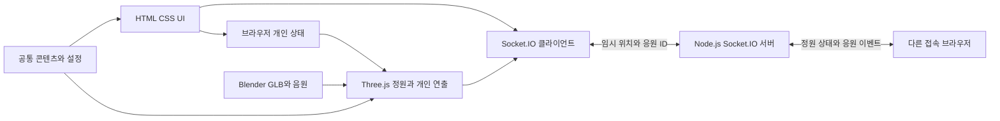

# 기술 설계와 통신 규칙

이 문서는 구현 계약 초안입니다. 아래 모듈과 이벤트는 아직 구현되지 않았습니다. 공통 타입은 `공통설정/contracts.ts`, 콘텐츠는 `content.json`, 조정 가능한 숫자는 `settings.json`에 있습니다.

## 구조와 데이터 흐름



감정 선택·고민 유형·사전/사후 값·호흡 진행률을 네트워크 모듈에 전달하지 않습니다. 콘텐츠 전체를 서버에 보내지 않고 서버도 동일한 응원 허용 목록을 읽습니다.

### 구현할 폴더

```text
mind-garden/
  package.json                 npm workspaces와 공통 명령
  package-lock.json            팀 공통 의존성 잠금
  apps/
    client/
      index.html
      src/
        main.ts                초기화와 정리
        scene/                 garden, forest, lake, plaza, player, environment
        ui/                    welcome, checkin, hud, activities, checkout
        state/                 session, activity reducers
        network/               connection, avatar synchronization, support
        audio/                 재생 허용과 음량
        content/               content.json과 settings.json의 단일 원본은 shared
      public/assets/           모델·음원·아이콘의 실행 파일
    server/src/
      index.ts                 HTTP 서버와 Socket.IO 초기화
      garden.ts                입장·퇴장·snapshot
      validation.ts            런타임 검증과 속도/전송 제한
      support.ts               응원 ID와 요청 중복 처리
  shared/
    contracts.ts
    content.json
    settings.json
  docs/                        이번 준비자료와 실행 기록
  asset-sources/               Blender 원본·라이선스 고지
```

프레임마다 HTML 전체를 다시 만들지 않습니다. UI는 상태 변경 시 갱신하고 3D는 하나의 렌더 루프를 유지합니다. 다시 시작할 때 모델·음원·이벤트 구독을 중복 생성하지 않으며 종료 시 정리합니다.

## 모듈 간 연결

| 제공자 | 계약 | 소비자와 책임 |
|---|---|---|
| 심가현 / 활동 상태 | `BreathingView {status, elapsedMs, progress}` | 장재혁: `updateBreathing(view)`로 안개·빛·꽃 갱신 |
| 장재혁 / 호수 | `LakeSceneApi.playRelease(onComplete)`, `cancelRelease()` | 심가현: 범주 선택과 버튼 상태 연결. 완료 callback에서 상태 전환 |
| 심가현 / 응원 선택 | `messageId`와 임시 `requestId` | 최주영: `sendSupport()` 호출과 확인 응답 처리 |
| 최주영 / 접속 상태 | `ConnectionStatus`, `GardenSnapshot` | 심가현: 상태 안내. 장재혁: 임시 아바타 생성·갱신·제거 |
| 최주영 / 이동 구조 | 로컬 좌표·`zoneAt(x,z)` | UI: 구역 패널 표시. 서버: 같은 설정으로 광장 여부 판정 |

UI가 Three.js 객체의 내부 좌표나 재질을 직접 수정하지 않도록 공개 메서드로 연결합니다. 인터페이스를 바꿀 때 제공자와 소비자의 작업을 함께 변경합니다.

## 개인 상태

`SessionState`는 감정, 고민 범주, 사전/사후 긴장감·편안함, 활동 상태, 호흡 경과시간, 음량 설정을 메모리에 유지합니다. 값이 없으면 `null`입니다. 새 체험·페이지 종료·새로고침 후 개인 응답은 유지하지 않습니다. 감정이나 평가값을 localStorage/sessionStorage/쿠키/URL에 저장하지 않습니다.

서버 접속 ID를 설문 식별자로 사용하지 않습니다. 연구용 평가 기록은 별도 동의와 빈 양식으로 운영합니다. 일반 실행에는 평가 응답을 외부로 보내는 분석 도구를 붙이지 않습니다. 관찰/평가 양식의 기록은 참가자가 동의한 별도 평가에 한하며 일반 체험의 자동 수집으로 구현하지 않습니다.

## Socket.IO 이벤트 초안

정원은 하나이고 최대 5명이 입장합니다. 서버는 `garden` room에 참가한 소켓만 아바타로 관리합니다. 통신 연결 성공과 정원 입장 성공을 구분합니다. 정원이 가득 차면 개인 체험 상태를 안내하고 공유 room에는 참가시키지 않습니다.

| 방향 | 이벤트 | 데이터 | 처리 |
|---|---|---|---|
| 클라이언트→서버 | `garden:join` | 빈 객체, ack | 기존 입장은 멱등 처리. 신규 입장은 최대 인원 확인 후 서버 ID·입구 좌표 배정 |
| 클라이언트→서버 | `avatar:move` | `{x,z,yaw,seq}` | 참가 여부·숫자·경계·순서·속도 검증 후 최신 위치 갱신 |
| 클라이언트→서버 | `support:send` | `{messageId,requestId}`, ack | 허용 ID·광장 위치·수신자·간격 확인 후 전달 |
| 서버→클라이언트 | `garden:snapshot` | `{players:[{id,x,z,yaw,zone}], serverTimeMs}` | 입장 직후와 100ms 주기로 현재 참가자 목록. 클라이언트는 빠진 ID 제거 |
| 서버→클라이언트 | `support:receive` | `{messageId,fromPlayerId,requestId,serverTimeMs}` | 클라이언트 공통 목록의 문구로 카드 표시. 알 수 없는 ID 무시 |
| 서버→클라이언트 | `garden:error` | `{code}` | 허용된 코드만 사용자 안내문으로 변환 |

`support:send` 성공 ack는 `{ok:true,requestId,recipientCount}`입니다. `recipientCount`는 서버가 전송 대상으로 선택한 현재 연결 수이며, 화면 표시가 확인된 인원 수는 아닙니다. 실패 ack는 `{ok:false,code,retryAfterMs?}`입니다.

실패 코드는 `ROOM_FULL`, `NOT_JOINED`, `INVALID_PAYLOAD`, `OUTSIDE_PLAZA`, `NO_RECIPIENT`, `RATE_LIMITED`로 통일합니다. 클라이언트의 연결 timeout은 서버 오류 코드와 구분해 자체 안내합니다.

## 서버 검증과 제한 제안

- TypeScript 타입만으로 외부 입력이 검증되지는 않습니다. 객체와 키를 검사하고 허용 필드 외의 입력은 거절합니다. 문자열 길이·숫자·유한값을 직접 검사합니다.
- 이동 x/z는 -25~25, yaw는 -π~π, seq는 증가하는 안전한 정수입니다. 클라이언트 ID·감정·범주·임의 문구·임의 구역을 받지 않습니다. ID는 소켓, 구역은 서버가 받아들인 좌표로 결정합니다.
- 이동 전송은 100ms 간격을 시작값으로 하며 정지 상태에서는 생략합니다. 서버는 소켓당 초당 15회 초과 입력을 무시합니다. 이동 변화는 서버 경과시간 기준 속도 3m/s와 작은 오차 0.5m 이내인지 확인합니다.
- 응원은 소켓당 5초 간격입니다. 송신자가 광장에 있고 다른 광장 참가자가 있을 때만 전달합니다. 수신자에 송신자를 포함하지 않습니다.
- 요청 ID는 1~64자의 영문·숫자·하이픈입니다. 서버는 소켓별 최근 요청 결과를 60초 동안 최대 20개 보관합니다. 중복 요청이면 이전 결과를 반환하고 다시 전달하지 않습니다. 검증 실패 입력은 중복 캐시에 넣지 않습니다.
- `RATE_LIMITED`와 `NO_RECIPIENT`도 유효 요청의 확정 결과입니다. 상태를 수정한 후 다시 보내는 새 시도는 새 요청 ID를 사용합니다. timeout으로 결과를 모를 때만 같은 ID로 재확인합니다.
- 같은 ID의 재확인은 최초 시도 후 60초 안에만 허용합니다. 캐시가 만료된 이전 요청을 재전송하면 새 전달이 될 수 있으므로 60초 이후에는 재확인 버튼을 닫고 새 요청을 명시적으로 시작하게 합니다.
- 서버의 최종 에셋/HTML과 소켓 허용 origin을 명시합니다. CORS만으로 WebSocket 접근 제한이 되지는 않으므로 필요하면 `allowRequest`에서 origin도 확인합니다. 이 제한은 로그인이나 사용자 인증을 대신하지 않습니다. [Socket.IO CORS 안내](https://socket.io/docs/v4/handling-cors/)

데이터베이스와 영구 메시지 기록은 두지 않습니다. 연결 종료 시 위치와 요청 캐시를 제거하고 서버 재시작 시 모든 임시 상태가 사라집니다. 인프라의 IP·접속 로그 생성 여부와 보관 설정은 실제 실행 환경을 정할 때 확인합니다.

## 연결 실패와 재접속

서버가 중단되어도 3D·개인 활동·체크아웃을 이용합니다. 응원 버튼은 공동 전송 불가로 안내합니다. 연결이 끊긴 동안 이동과 응원을 Socket.IO의 전송 대기열에 쌓지 않습니다. 이동은 연결 중일 때만 `volatile` 이벤트로 보내고 응원은 연결/입장 상태를 확인한 뒤 명시적으로 전송합니다.

재접속 시 새 서버 ID를 받을 수 있습니다. `garden:join`을 다시 수행하고 기존 원격 아바타를 지운 뒤 snapshot을 적용합니다. 개인 감정과 완료 상태는 그 브라우저에 남지만 위치는 서버의 입구 위치로 맞춥니다. 개인 정보와 과거 응원은 서버에 복원 요청하지 않습니다.

Socket.IO의 기본 전송은 연결 중 유실 가능성이 있어 응원 요청에 ack와 중복 방지를 설계했습니다. 서버가 중단된 동안의 메시지 복구와 오프라인 전달은 이번 범위에 포함하지 않습니다. [Socket.IO 전달 보장](https://socket.io/docs/v4/delivery-guarantees/)

## 구현 전에 확인할 위험

학교 Wi-Fi가 장치 간 접속을 차단하면 같은 네트워크에서도 접속이 실패할 수 있습니다. 먼저 연결 시험을 하고 LAN·허용된 핫스팟·별도 실행 서버 중 가능한 방식을 결정합니다. 외부 접속에는 웹 파일과 실행 중인 실시간 서버, HTTPS/WSS 설정이 필요합니다. 정적 웹 파일 배포만으로 공동 접속 서버가 생성되지는 않습니다.
